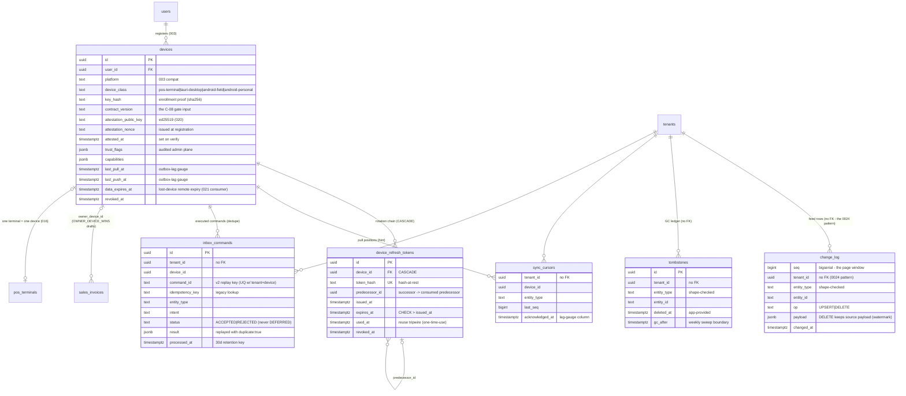

# ERD — Offline Sync Cluster (PHASE-020)

> **Status:** DELIVERED (PHASE-020, migrations `0029_sync_foundation.sql` +
> `0030` + `0031`; the 016 slice in `0024_pos_core.sql`) ·
> **Owner:** Database Architecture · **Updated:** 2026-11-04 · **Phases:** 016 (slice) / 020

Core attributes only. Column-level specifications live in
[TABLES/sync.md](../TABLES/sync.md) (authored in PHASE-020) — sync rule in
[database README](../README.md#synchronization-rule-normative); the Drizzle
schema is the machine-readable mirror. The sync substrate carries **no FKs on
tenant_id** by design (tenant deletes never cascade through sync
bookkeeping); `devices`/`device_refresh_tokens` are identity-owned,
service-mediated (no tenant_id, no RLS — the PHASE-003 §4 rule).

Note: `sales_invoices.owner_device_id` (0029) is the only FK-carrying sync
addition into a business table — stamped at device draft creation, checked on
`update_draft`, re-stamped by the admin reassign route
([../../offline/CONFLICT_RESOLUTION.md](../../offline/CONFLICT_RESOLUTION.md)
§2 OWNER_DEVICE_WINS). The `permissions` snapshot rows ride `change_log` with
`entity_type = 'permissions'` (per-device-user key sets, ≤ 1 row / 6d idle;
[SECURITY_AND_DEVICE_MANAGEMENT.md](../../offline/SECURITY_AND_DEVICE_MANAGEMENT.md)
§4).
