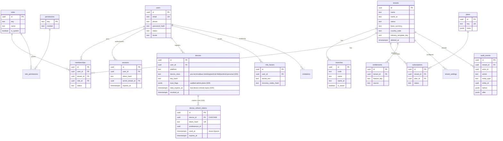

# ERD — Tenancy & Identity Cluster

> **Status:** STABLE · **Owner:** Database Architecture · **Updated:** 2026-11-04 · **Phases:** 002–004 (devices widened 016/020)

Core attributes only (full column specs: [TABLES/tenancy-identity.md](../TABLES/tenancy-identity.md);
the 020 registry widening + the credential chain live in [TABLES/sync.md](../TABLES/sync.md) +
[ERD/sync.md](sync.md)).
All tenant-owned tables additionally carry `tenant_id`, `created_at`, `updated_at`,
`version` ([DATABASE_CONVENTIONS.md](../DATABASE_CONVENTIONS.md)).

Note: `sessions.active_tenant_id` is a convenience reference to the user's selected
membership — authorization still derives from `memberships`, never from this column
([../architecture/MULTI_TENANCY.md](../../architecture/MULTI_TENANCY.md)).
