# Completeness Roadmap — The Full-ERP Program (PHASE-035…065)

> **Status:** ACCEPTED — THE AUTHORITATIVE PLAN · **Owner:** Product Owner & Platform Architecture · **Date:** 2026-11-10
> **Canonical register:** [COMPLETENESS_REGISTER.md](COMPLETENESS_REGISTER.md) (CR-01…CR-40) · **Evidence base:** [gap-analysis/](gap-analysis/) (the three independent audit reports)
> **Reading rule:** this roadmap is the INDEX; the phase document is authoritative for its scope. If they conflict, the phase document wins and this file must be corrected.

---

## 0. الملخص التنفيذي بالعربية — كيف تستخدم هذه الخطة

**ما هذه الوثيقة؟** هذه هي الخطة الرئيسية لتحويل المنصة من نظام ERP بمستوى نضج L3.2 (60% من ERP متكامل وفق التدقيق المستقل) إلى **نظام ERP شامل ومتكامل بكل ما تعنيه الكلمة**، عبر **31 مرحلة جديدة (PHASE-035 حتى PHASE-065)** موزعة على **4 موجات**، تسد **495 فجوة مدقَّقة** بالإضافة إلى إضافات المالك.

**ما الذي استُثني من الخطة (لأنه نُفِّذ وسُلِّم فعلاً في `ERP_PLATFORM_PHASE034_FINAL.zip` بتاريخ 2026-11-09):**
1. ✅ **القالب القطاعي الثالث عشر `industry.rental_logistics`** — نُفِّذ كاملاً (الترحيل `0047` + الثوابت + الاختبارات + التوثيق) — كانت فجوة «قالب واحد مؤجَّل من 13» في التدقيق.
2. ✅ **الواجهة التسويقية (الصفحة الرئيسية العامة)** — نُفِّذت في جذر الموقع العام (hero + أعمدة المزايا + سجل القوالب الثلاثة عشر + لمحة الخطط + التذييل، بـ38 مفتاح ترجمة ثنائي).
3. ✅ **موجودة أصلاً منذ المراحل 1–11** (ولا تُعاد): لوحة تحكم المنصة، تدفق الاشتراك والفوترة و`/checkout`، ومعالج تحديد النشاط التجاري عند التهيئة.

**كيف تبدأ تنفيذ مرحلة؟** في محادثة جديدة (أو نفس المحادثة) قل: **«ابدأ تنفيذ المرحلة PHASE-0NN»** — الوكيل يقرأ `docs/handoff/AGENT_START_HERE.md` ثم وثيقة المرحلة `docs/implementation/phases/PHASE-0NN.md` وينفّذ بروتوكول الخطوات الخمس عشرة. عند اكتمال المرحلة يُسلَّم الأرشيف **`ERP_PLATFORM_PHASE0NN.zip`** (وفق اصطلاح التسليم OA-07)، وتُحدَّث `IMPLEMENTATION_STATUS.md` بتقرير الإكمال.

**ترتيب التنفيذ الموصى به:** تسلسلي داخل كل موجة (035 ← 041 ثم 042 ← 051 …) لأن كل مرحلة تبني على سابقتها (انظر §5). المرحلة **035** هي نقطة البداية المثالية: أسبوع واحد، سدّ فجوات التنشيط + استعادة صدق التوثيق.

**ملاحظة البوابة التجارية:** قرار التسعير **OQ-002** (الأسعار النهائية للخطط) ليس مرحلة — إنه قرار مالك يُسجَّل في `SUBSCRIPTION_AND_ENTITLEMENTS.md` ويُفترض محسوماً عند وصول الموجة الأولى لبوابتها.

---

## 1. Program summary

| Dimension | Value |
|---|---|
| Phases | **31** — PHASE-035…065 (IDs immutable per CR-37) |
| Waves / stage groups | **4** — stages 12–15 (CR-01) |
| Audited gaps closed | **495** numbered gaps from the three audit reports + owner additions (OA-01…07) |
| Excluded (already delivered 2026-11-09) | rental_logistics template · marketing landing (CR-02) |
| Confirmed shipped (never re-implemented) | platform console · subscription/billing + checkout · onboarding activity wizard (CR-04) |
| Discipline | every phase ships with the CR-36 gates (SQL+Drizzle+catalog parity, permission zero-drift, AR/EN parity, docs:validate, RLS attack tests, feature flags, sync-surface assessment) |
| Delivery convention | `ERP_PLATFORM_PHASE0NN.zip` per completed phase (OA-07) |

## 2. The four waves

| Wave / Stage | Phases | Gate | Theme |
|---|---|---|---|
| **Wave 1 — Stage 12** | 035–041 | **Sellable** (ZATCA-1 ✓ + OQ-002 resolved + payments-ready path) | سدّ الفجوات الحرجة التي تمنع البيع |
| **Wave 2 — Stage 13** | 042–051 | **Full ERP** (MRP + HR + WMS + projects live) | اكتمال الوحدات: تصنيع، مستودعات، موارد بشرية، مشاريع، جودة، تجارة خارجية |
| **Wave 3 — Stage 14** | 052–059 | **Enterprise** (API platform + SSO + BI + operations) | المنصة المؤسسية: سير عمل، عمق محاسبي، ضرائب، تكاملات، حوكمة، تشغيل |
| **Wave 4 — Stage 15** | 060–065 | **Differentiated** (Arabic/AI/growth advantages) | التميّز: عمق المبيعات ونقاط البيع، تجربة المستخدم، الخليج والعربية، الذكاء الاصطناعي، النمو |

## 3. Phase index

| Phase | Title (EN) | العنوان (AR) | Wave | Effort | Closes (primary gap IDs) |
|---|---|---|---|---|---|
| PHASE-035 | Activation & Truth Restoration | التنشيط واستعادة صدق التوثيق | 1 | ~1–2 weeks | EVAL-F-1…F-9 · H-18 · audit §9.ج/د |
| PHASE-036 | Extensibility Core — Custom Fields | نواة القابلية للتوسعة — الحقول المخصصة | 1 | ~3–4 weeks | FD-18 · FD-19 · FD-20 · DF-39 |
| PHASE-037 | ZATCA Phase-1 & QR Compliance | الامتثال السعودي (المرحلة الأولى) ورمز QR | 1 | ~2–3 weeks | H-01 (P1) · H-02 · X-08 (P1) |
| PHASE-038 | Procurement Sourcing & Supplier Collaboration | دورة المنافسة الشرائية وتعاون الموردين | 1 | ~3–4 weeks | H-11 · P-01…P-15 · DF-52/53 |
| PHASE-039 | Returns & Collections (RMA + Dunning) | المرتجعات والتحصيل | 1 | ~2–3 weeks | H-12 · H-13 · S-14…S-16 · credit-risk |
| PHASE-040 | Data Onboarding & Migration Toolkit | عدة التهيئة والترحيل | 1 | ~2–3 weeks | H-17 · IN-26 · TB-19/20 · OA-05 |
| PHASE-041 | Communications Hub | مركز الاتصالات (واتساب/SMS/بريد) | 1 | ~2–3 weeks | H-22 · N-06…N-08 · IN-13…18 · FD-30 · TB-23 |
| PHASE-042 | Manufacturing I — Routing & Work Centers | التصنيع ١ — مسارات التشغيل ومراكز العمل | 2 | ~4–6 weeks | H-04 · M-02…M-04 · M-12…M-19 |
| PHASE-043 | Manufacturing II — MRP & Planning | التصنيع ٢ — تخطيط الاحتياجات | 2 | ~6–8 weeks | H-03 · M-01 · M-05…M-11 · M-21/22/24/25 · S-10 · I-14 |
| PHASE-044 | WMS & Inventory Intelligence | إدارة المستودعات والذكاء المخزني | 2 | ~6–8 weeks | H-07 · I-01…I-25 · PP-11/12 · DF-12/17 |
| PHASE-045 | HR Core — Attendance, Leaves & Shifts | الموارد البشرية الأساسية | 2 | ~4–6 weeks | H-05 (part) · HR-01…04 · HR-13 · N-17 |
| PHASE-046 | HR Payroll Compliance | الامتثال الرواتبي (GOSI/الضريبة/نهاية الخدمة) | 2 | ~3–4 weeks | HR-11 · HR-12 · X-02 · IN-06 |
| PHASE-047 | HR Growth — Talent & Performance | نمو الموارد البشرية — المواهب والأداء | 2 | ~4–6 weeks | HR-05…HR-10 · DF-51 |
| PHASE-048 | Projects & Contracting | المشاريع والمقاولات | 2 | ~5–6 weeks | H-06 · PR-01…PR-15 · DF-08 |
| PHASE-049 | CMMS — Asset Maintenance | صيانة الأصول | 2 | ~3–4 weeks | H-15 · FA-F-01…F-13 |
| PHASE-050 | Quality Management (QMS) | إدارة الجودة | 2 | ~3–4 weeks | Q-01…Q-12 · M-23 |
| PHASE-051 | Foreign Trade & Logistics | التجارة الخارجية واللوجستيات | 2 | ~4–5 weeks | H-08 · L-01…L-14 |
| PHASE-052 | Workflow & Approvals Engine | محرك سير العمل والموافقات | 3 | ~4–6 weeks | H-14 · W-01…W-12 · PP-17 · UX-13 |
| PHASE-053 | Accounting Depth & Treasury | العمق المحاسبي والخزينة | 3 | ~5–6 weeks | A-01…A-15 · T-01…T-13 · S-19 · DF-55 |
| PHASE-054 | Tax & Corporate Compliance | الضرائب والامتثال المؤسسي | 3 | ~5–7 weeks | X-01…X-13 · N-02 · H-16 · G-08 |
| PHASE-055 | Public API & Webhooks Platform | منصة الـ API والـ Webhooks العامة | 3 | ~3–4 weeks | H-21 · N-10/11/21 · IN-19…25 · UX-09 · N-15 |
| PHASE-056 | Payments & Commerce Integrations | المدفوعات وتكاملات التجارة | 3 | ~4–5 weeks | H-09 · IN-01…04 · IN-07…10 · N-03…05 · S-13 |
| PHASE-057 | BI & Analytics | ذكاء الأعمال والتحليلات | 3 | ~5–6 weeks | R-01…R-15 · F-7 · PP-20…27 |
| PHASE-058 | Enterprise Identity & Governance | الهوية المؤسسية والحوكمة | 3 | ~4–5 weeks | H-20 · IN-28…32 · G-01…G-13 · G-19/20 · UX-19 |
| PHASE-059 | Platform Operations & Trust | عمليات المنصة والثقة | 3 | ~5–6 weeks | H-19 · PL-01…18 · TB-21/24/25/26/27/31/32/33/35 · G-14…18 · FD-33 · OA-03 |
| PHASE-060 | Sales & CRM Depth | عمق المبيعات وإدارة العملاء | 4 | ~4–5 weeks | S-01…S-07 · S-10/11/17/18/20/21 |
| PHASE-061 | POS & Retail Depth | عمق نقاط البيع والتجزئة | 4 | ~3–4 weeks | S-08/S-09 · IN-11/12 · N-16/18/19 |
| PHASE-062 | UX Excellence & Document Design | تميّز التجربة وتصميم المستندات | 4 | ~5–7 weeks | TB-01…18/22/34 · FD-01…17/21…29/34/35 · H-23 · UX-02…09/11…18 · PP-01…10/13/14/18/19/29…34 · OA-01 |
| PHASE-063 | Gulf & Arabic Differentiators | المميزات الخليجية والعربية | 4 | ~4–6 weeks | DF-01…06/08/10/54 · OA-01 |
| PHASE-064 | AI Copilot & Intelligent Automation | المساعد الذكي والأتمتة | 4 | ~5–6 weeks | DF-25…DF-35 · UX-20 · PP-16 · G-07 |
| PHASE-065 | Growth Platform & Customer Success | منصة النمو ونجاح العملاء | 4 | ~3–4 weeks | DF-36…50 · TB-28/29/30 · UX-16 |

> **Effort figures** are planning estimates for a single senior full-stack agent working
> phase-by-phase with the house discipline gates; they are not delivery promises.

## 4. Exclusions — delivered or already shipped (NEVER re-plan)

| Item | Evidence |
|---|---|
| 13th template `industry.rental_logistics` | migration `0047` + contracts constants + 4 reconciliations — CHANGELOG 2026-11-09 |
| Marketing landing surface | public root landing (38 bilingual keys) — CHANGELOG 2026-11-09 |
| Platform admin console / subscription+checkout / onboarding activity wizard | audit §5.1 + F-4 confirm shipped (CR-04) |
| Audit §21 "exists & excellent — do not touch" (posting engine, RLS, decimal discipline, ⌘K + shortcuts, offline clients, consolidation, 8 reconciliations, template discipline) | preserved by CR-36 gates |

## 5. Dependency graph (summary)

```mermaid
flowchart TB
  subgraph W1["Wave 1 — Sellable Foundation (Stage 12)"]
    P035[P035 Activation & Truth] --> P036[P036 Extensibility Core]
    P035 --> P037[P037 ZATCA Phase-1 + QR]
    P035 --> P038[P038 Procurement Sourcing]
    P035 --> P039[P039 Returns + Collections]
    P035 --> P040[P040 Onboarding & Migration]
    P035 --> P041[P041 Communications Hub]
  end
  subgraph W2["Wave 2 — Full-ERP Completion (Stage 13)"]
    P036 --> P042[P042 Mfg I Routing/WC]
    P042 --> P043[P043 Mfg II MRP]
    P038 --> P043
    P044[P044 WMS] --> P043
    P035 --> P044
    P045[P045 HR Core] --> P046[P046 Payroll Compliance]
    P046 --> P047[P047 HR Growth]
    P048[P048 Projects & Contracting]
    P049[P049 CMMS]
    P050[P050 QMS]
    P051[P051 Foreign Trade]
  end
  subgraph W3["Wave 3 — Enterprise Platform (Stage 14)"]
    P036 --> P052[P052 Workflow Engine]
    P052 --> P053[P053 Accounting Depth & Treasury]
    P037 --> P054[P054 Tax Compliance + ZATCA-2/ETA]
    P055[P055 Public API & Webhooks]
    P041 --> P056[P056 Payments & Commerce]
    P055 --> P056
    P057[P057 BI & Analytics]
    P058[P058 Identity & Governance]
    P059[P059 Platform Ops & Trust]
  end
  subgraph W4["Wave 4 — Differentiation & Growth (Stage 15)"]
    P060[P060 Sales & CRM Depth]
    P041 --> P061[P061 POS & Retail Depth]
    P036 --> P062[P062 UX Excellence]
    P055 --> P064[P064 AI Copilot]
    P062 --> P065[P065 Growth Platform]
    P063[P063 Gulf & Arabic Differentiators]
  end
  W1 --> W2 --> W3 --> W4
```

**Hard ordering rules:** 035 first (truth + activation). 036 before 042+ (custom fields surface on new modules). 042 before 043. 045 before 046 before 047. 052 before 053 (approval chains gate treasury ops). 037 before 054 (ZATCA-2 builds on Phase-1 chain). 055 before 056 (webhooks/events feed commerce). 062 before 065 (white-label + trust surfaces feed growth). Within a wave, phases without an edge between them MAY run in parallel by separate agents.

## 6. Complete gap→phase mapping

Every numbered gap from the three audit reports maps to exactly one owning phase
(or is explicitly excluded / kept non-goal). Two `F-` families exist in the sources —
disambiguated here: **EVAL-F-*** (screen gaps, evaluation report §5.2) and **FA-F-***
(fixed-asset gaps, full-gap report §9).

### 6.1 Critical gaps (H-01…H-23)

| Gap | Owner | Note |
|---|---|---|
| H-01 ZATCA | **037** (Phase-1) + **054** (Phase-2 clearance/CSID/XAdES) | GATE discipline preserved |
| H-02 QR text-not-image | **037** | real scannable QR |
| H-03 MRP | **043** | |
| H-04 Routing/WC | **042** | |
| H-05 HR | **045/046/047** | core → compliance → growth |
| H-06 Projects | **048** | |
| H-07 Bins/locations | **044** | |
| H-08 LC/foreign trade | **051** | |
| H-09 Payment provider | **056** | DR-002 resolved there |
| H-10 Pricing placeholder | **OQ-002 entry condition** (CR-39) | owner decision, not a phase |
| H-11 RFQ | **038** | |
| H-12 RMA | **039** | |
| H-13 Dunning | **039** | |
| H-14 Multi-level approvals | **052** | |
| H-15 CMMS | **049** | |
| H-16 Non-VAT taxes | **054** | |
| H-17 Import kinds | **040** | |
| H-18 items.import_export grant | **035** | one-line migration |
| H-19 Tenant backup/restore | **059** | |
| H-20 SSO/SAML/LDAP | **058** | |
| H-21 API keys/webhooks | **055** | |
| H-22 WhatsApp/SMS | **041** | |
| H-23 Locales > AR/EN | **062** | framework; AR/EN stay canonical |

### 6.2 Module families

| Family | Range | Owner phase(s) |
|---|---|---|
| Accounting (A) | A-01…A-15 | **053** (A-13 shares ECM surfaces with 062) |
| Sales (S) | S-01…S-21 | **060** (S-10 ATP → **043**; S-13 shipping → **056**; S-14/15/16 → **039**; S-19/DF-55 → **053**; S-20 portal → **060**; S-21 drop-ship → **060**) |
| Purchasing (P) | P-01…P-15 | **038** (P-05 portal infra shared with S-20 in 060; P-07 safety stock auto → **043**; P-11 3-way tolerance → **038**) |
| Inventory (I) | I-01…I-25 | **044** (I-14 reservation policy → **043**; I-15 auto-UOM → **044**) |
| Manufacturing (M) | M-01…M-25 | **042** (M-02…04, M-12…19) · **043** (M-01, M-05…11, M-21/22/24/25) · **050** (M-23) |
| Quality (Q) | Q-01…Q-12 | **050** |
| Fixed assets (FA-F) | FA-F-01…F-15 | **049** (F-10 tax depreciation + F-14 partial disposal + F-15 IFRS-16 leases → **054** with tax pack) |
| HR | HR-01…HR-15 | **045** (01…04, 13) · **046** (11, 12) · **047** (05…10) — HR-14/15 already shipped (audit §10) |
| Projects (PR) | PR-01…PR-15 | **048** |
| Treasury (T) | T-01…T-13 | **053** (T-05 open-banking feed shared with **056**) |
| Tax (X) | X-01…X-13 | **054** (X-02 → **046**; X-08 P1 → **037**) |
| Foreign trade (L) | L-01…L-14 | **051** |
| BI/Reports (R) | R-01…R-15 | **057** |
| Workflow (W) | W-01…W-12 | **052** |
| Integrations (N) | N-01…N-21 | **037/054** (N-01, N-02) · **041** (N-06…08) · **045** (N-17) · **047** (N-14) · **055** (N-10, N-11, N-15, N-21) · **056** (N-03…05, N-09) · **061** (N-16, N-18, N-19) · **040** (N-20) |
| Platform (PL) | PL-01…PL-18 | **059** |
| Governance (G) | G-01…G-20 | **058** (G-01…13, G-19, G-20) · **059** (G-14…18) · **054** (G-08 compliance calendar) |
| UX | UX-01…UX-20 | UX-01 **excluded** (delivered) · **062** (02…09, 11…18) · **064** (UX-20) · UX-13 → **052** · UX-14 → **041** · UX-19 → **058** |

### 6.3 Part-two families (functional depth / integration / table stakes / polish / differentiators)

| Family | Range | Owner phase(s) |
|---|---|---|
| Functional depth (FD) | FD-01…FD-35 | **036** (18, 19, 20) · **040** (FD-18 wizard leverage) · **041** (FD-30) · **044** (PP-11/12 adjacent) · **057** (PP-20…27) · **059** (FD-31…33 via gates + sandbox) · **062** (01…17, 21…29, 34, 35) |
| Integration (IN) | IN-01…IN-32 | **037** (IN-05 partial JoF→063) · **040** (IN-26) · **041** (IN-13…18) · **045** (IN-06 devices, N-17) · **047** (IN-06 external HR = DF-51) · **055** (IN-19…23, IN-25) · **056** (IN-01…12) · **061** (IN-11/12 hardware, N-16/18/19) · **058** (IN-28…32) |
| Table stakes (TB) | TB-01…TB-35 | **040** (TB-19/20) · **041** (TB-23) · **059** (TB-21, 24…27, 31…33, 35) · **062** (TB-01…18, 22, 34) · **065** (TB-28…30) |
| Professional polish (PP) | PP-01…PP-34 | **039** (collections nudges→041) · **041** (PP-13, PP-15) · **044** (PP-11/12) · **052** (PP-17) · **053** (PP-05…09 accountant pack) · **057** (PP-20…27) · **058** (PP-28) · **062** (PP-01…10, 14, 18, 19, 29…34) · **064** (PP-16) |
| Differentiators (DF) | DF-01…DF-55 | Shipped: DF-04, 07, 09, 11, 14, 15, 16, 18…24 (do not touch) · **038** (DF-52/53) · **040** (DF-18 extend) · **043** (DF-24 replenishment) · **044** (DF-12, DF-17) · **047** (DF-51) · **048** (DF-08) · **053** (DF-55) · **060** (S-family) · **061** (retail) · **062** (DF-13 PWA) · **063** (DF-01…06, 10, 54) · **064** (DF-25…35) · **065** (DF-36…50) · **kept non-goal:** DF-38 (app marketplace — ecosystem play, not ERP completeness; plugin substrate delivered by 036 instead), DF-41 (built-in storefront — served by 056 connectors instead), DF-40/42 (marketing websites — optional 065 follow-ups, noted not committed) |

### 6.4 Evaluation-report screen gaps (EVAL-F)

| Gap | Owner | Note |
|---|---|---|
| EVAL-F-1 batches/serials/expiry screens | **035** | API already live |
| EVAL-F-2 adjustments surface | **035** | |
| EVAL-F-3 consolidated nav registration | **035** | |
| EVAL-F-4 contextual routes confirmation | **035** | documentation note only |
| EVAL-F-5 import/export grant | **035** | migration + nav verify |
| EVAL-F-6 e-invoicing-log report | **035** | report contract |
| EVAL-F-7 scheduled reports claim | **035** truth-record → **057** implementation | |
| EVAL-F-8 customer portal classification | **035** decision-record → **060** implementation | |
| EVAL-F-9 platform.payouts claim | **035** decision-record → **059** implementation | |

## 7. Owner additions (beyond the audits)

OA-01 Arabic-Indic numerals → 063 · OA-02 sync-fleet duty → CR-36 all · OA-03 SDAIA note → 059 · OA-04 ⌘K coverage → CR-36 all · OA-05 demo tenants → 040 · OA-06 performance budgets → CR-36 all · OA-07 delivery convention → register.

## 8. Execution protocol (for future conversations)

1. The user says: **«ابدأ تنفيذ المرحلة PHASE-0NN»**.
2. The implementing agent follows `docs/handoff/AGENT_START_HERE.md` (15 steps) with this roadmap + [COMPLETENESS_REGISTER.md](COMPLETENESS_REGISTER.md) as the v3.0 authority.
3. The agent implements the phase document `docs/implementation/phases/PHASE-0NN.md` under the CR-36 discipline gates, runs the local gates, and appends `reports/PHASE-0NN-COMPLETION.md`.
4. `IMPLEMENTATION_STATUS.md` row flips to COMPLETE with evidence; `NEXT_ACTION.md` points to the next eligible phase.
5. The agent delivers the repository state as **`ERP_PLATFORM_PHASE0NN.zip`** (OA-07).
6. On delivery, the user may continue with the next phase in the same conversation or attach the new archive in a fresh one — both work identically because the phase docs are self-contained.

**Resumption rule:** if a conversation is interrupted mid-phase, the next agent MUST reconcile `IMPLEMENTATION_STATUS.md` + git state + the phase doc before writing any code (protocol step 8/9), then continue from the recorded TODO checkpoint rather than restarting.

---

*Authored 2026-11-10 as part of the completeness planning session. This roadmap, the
register, and the 31 phase documents constitute Blueprint v3.0. Validation:
`scripts/validate_docs.py` (check 8) verifies the artifact set.*
