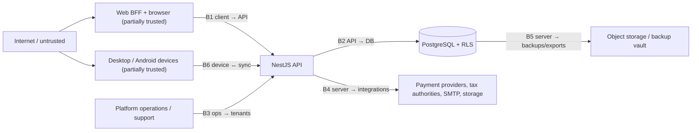

# Threat Model

> **Status:** STABLE · **Owner:** Security Architecture · **Updated:** 2026-11-06 (PHASE-024 update cycle — §8)

STRIDE-based threat model for the Universal Business ERP Platform (multi-tenant SaaS,
Arabic-first, MENA/GCC). This is the planning-level security baseline: it inventories
assets, defines trust boundaries, enumerates threats per boundary with existing controls,
and works the highest-priority scenarios in detail. Operational security testing is
specified in [SECURITY_TEST_PLAN.md](SECURITY_TEST_PLAN.md); incident handling in
[INCIDENT_RESPONSE.md](INCIDENT_RESPONSE.md). Architectural decisions:
[ADR-0005](../architecture/ADR/ADR-0005-multi-tenancy.md) (tenancy),
[ADR-0015](../architecture/ADR/ADR-0015-authentication.md) (auth),
[ADR-0012](../architecture/ADR/ADR-0012-offline-sync.md) (offline).

## 1. Method and scope

- **Method**: STRIDE (Spoofing, Tampering, Repudiation, Information disclosure, Denial of
  service, Elevation of privilege) applied per trust boundary, then per-asset.
- **Scope**: web app (Next.js BFF), API (NestJS modular monolith), PostgreSQL, jobs
  (pg-boss), object storage, desktop (Tauri) and Android (Expo) clients with SQLite
  offline sync, external integrations (payment providers, tax authorities).
- **System state**: MAINTAINED — the **PHASE-024 update cycle** (§8 note) folded
  every surface shipped through PHASE-023 plus the PHASE-024 hardening surfaces
  into this model; controls cited for those surfaces are the *implemented*
  controls, linked to the test suites that prove them. Surfaces not yet shipped
  (e.g., a live payment provider — DR-002 OPEN) keep the *specified* reading with
  target ratings until their implementing phase completes.
- **Risk rating**: L/M/H per `likelihood × impact` with rationale in §5; anything that
  breaks tenant isolation or ledger integrity is H by definition (see
  [../planning/RISK_REGISTER.md](../planning/RISK_REGISTER.md) RISK-010, RISK-009).

## 2. Asset inventory

| # | Asset | Examples | Primary security properties | Impact if compromised |
|---|-------|----------|------------------------------|----------------------|
| AS-1 | Financial data | journal entries/lines, GL balances, invoices, receipts, payments, subledgers, stock valuation | **Integrity** first (immutability, INV-003), confidentiality second | H — corrupted books destroy the product's core promise (RISK-009) |
| AS-2 | Credentials & session material | argon2id password hashes, session records, device refresh tokens, opt-in device push tokens (PHASE-022), TOTP secrets, recovery codes | Confidentiality + revocability | H — account takeover, tenant-wide fraud |
| AS-3 | Tax authority certificates & keys | ZATCA signing certificates/private keys, ETA credentials (PHASE-023) | Confidentiality (HIGHEST sensitivity class — [SECRETS_MANAGEMENT.md](SECRETS_MANAGEMENT.md)) | H — forged legally-valid invoices; regulatory exposure (RISK-005) |
| AS-4 | PII | partner contacts, addresses, tax registration numbers, national IDs (only where a jurisdiction pack requires for e-invoicing), user emails/phones | Confidentiality, minimization | M–H — regulatory/privacy exposure, spam/enrichment value |
| AS-5 | Audit trail | `audit_events` (append-only, integrity-chained) | Integrity, non-repudiation | H — erases forensic ability; compliance breach |
| AS-6 | Platform control data | tenants, plans, subscriptions, entitlements, feature flags, tenant offboarding state, deletion certificates, purge grants (PHASE-024) | Integrity (a suspended tenant must stay suspended; a purge must be real and evidenced) | M — entitlement theft, suspension evasion, destructive-path abuse |
| AS-7 | Documents & files | attachments, PDF/Excel exports, e-invoicing payloads | Confidentiality (tenant-scoped), availability | M–H — bulk exfiltration surface |
| AS-8 | Backups & exports | nightly dumps (encrypted, WORM-object-locked), offboarding export packages | Confidentiality, immutability (anti-ransomware) | H — full-platform data loss event |
| AS-9 | Offline device data | encrypted SQLite store, device keys in OS keychain, permission snapshots | Confidentiality (at rest), revocability | M — a stolen device must yield nothing useful |
| AS-10 | Service availability | API, DB, job queue, sync endpoints | Availability (NFR-007: 99.5% monthly) | M — business downtime for all tenants; DoS is per-boundary concern |
| AS-11 | Source & supply chain | npm dependencies, Docker images, CI pipelines, Tauri/Expo build toolchains | Integrity | H — malicious update = universal compromise |
| AS-12 | E-invoicing submission evidence | `e_invoicing_submissions` registry rows (the only acceptance truth), AES-256-GCM sealed payload/response artifacts, append-only certificate-usage log (PHASE-023) | Integrity + authenticity (legal-weight acceptance record) | M–H — a forged acceptance state is a compliance-integrity break (legal exposure, RISK-005 adjacency) |

## 3. Trust boundaries

| ID | Boundary | Crosses from → to | Key trust rule |
|----|----------|-------------------|----------------|
| B0 | Internet → client | untrusted users/devices → browser/app shell | All client input is hostile; client is never authoritative (server-authoritative posting, ADR-0012) |
| B1 | Client → API | browser BFF / device tokens → API | Tenant context derives ONLY from the authenticated session/membership — never from client input (ADR-0005) |
| B2 | API → DB | app code (may contain bugs) → data | RLS as the safety net under scoped queries; app role is not table owner |
| B3 | Ops → tenants | platform staff → tenant data | Every access is permissioned, time-boxed, and audited; no standing access |
| B4 | Server → integrations | API/adapters → third parties | Keys never touch code; egress allow-listed per adapter; callbacks verified by signature |
| B5 | Server → backups/exports | data at rest leaving the hot path | Encrypted, WORM-locked, tenant-scoped signed URLs, audited |
| B6 | Server ↔ offline devices | sync endpoints ↔ registered devices | Devices hold scoped, revocable credentials; pushes are idempotent commands, never replication |

## 4. Threats per boundary (STRIDE)

### B0 — Internet → client

| Threat | STRIDE | Attack examples | Existing controls | Residual | Detection |
|--------|--------|-----------------|-------------------|----------|-----------|
| XSS in user-rendered content | Tampering / Info disclosure | Arabic/English product descriptions, partner names, print templates containing `<script>` or `javascript:` URLs | CSP + Trusted Types posture, React/Next auto-escaping, no `dangerouslySetInnerHTML` on user data, SRI for third-party assets ([../architecture/SECURITY_ARCHITECTURE.md](../architecture/SECURITY_ARCHITECTURE.md)) | L | CSP violation reports; anomaly in audit (unexpected session IPs) |
| CSRF on state-changing actions | Spoofing / Tampering | forged third-party page posting an approval | double-submit CSRF token + `SameSite=Lax` httpOnly cookies (ADR-0015); approval routes re-authenticate permission server-side | L | CSRF token failures counter; audit event correlation |
| Clickjacking / tabnabbing | Spoofing | overlay attack on approval screens | `X-Frame-Options: DENY` + frame-ancestors CSP; `rel=noopener` | L | header verification test in CI |
| Malicious client tampering | Tampering | modified desktop APK/Tauri bundle posting fake "posted" state | server-authoritative finalization; local records stay `PENDING_SYNC`; official numbers only from server (ADR-0012, A-010) | L (integrity of server data unaffected) | sync rejection events |
| Malicious client update via updater channel (PHASE-021/022, key class [S-15](SECRETS_MANAGEMENT.md) §1) | Tampering / Elevation | compromised release pipeline or stolen update-signing key serving a malicious desktop/Android build to the fleet | minisign-signed desktop artifacts + Android app signing (S-15, high-sensitivity key class); **minimum-version enforcement** (force-update push); staged rollout 10%→50%→100% with crash-free halt gates (< 98.5% → revert to last-known-good); CI uses OIDC/scoped tokens ([../planning/RELEASE_STRATEGY.md](../planning/RELEASE_STRATEGY.md)); desktop shell + mobile shell tamper checks (check:desktop-shell / check:mobile-shell) | M — a stolen signing key is a universal-compromise path; rotation is itself a client-update event (S-15 procedure) | update-channel distribution + crash-gate halts on the client-stability dashboard ([../operations/MONITORING.md](../operations/MONITORING.md)); behavioral egress monitoring (S-13) |

### B1 — Client → API

| Threat | STRIDE | Attack examples | Existing controls | Residual | Detection |
|--------|--------|-----------------|-------------------|----------|-----------|
| Credential stuffing / brute force | Spoofing | password spraying against `/auth/login` | argon2id, progressive lockout, rate limiting, breached-password rejection, login notifications (ADR-0015) | L–M | failed-login spike metric (OBSERVABILITY.md business SLO set) |
| Stolen session cookie | Spoofing | XSS elsewhere / network sniff / device theft | httpOnly+Secure cookies, 12h absolute / 30min idle timeout, server-side revocation, MFA step-up possible per policy | M (session theft before rotation window closes) | impossible-travel / new-device audit events |
| Tenant spoofing via body/header | Elevation | `tenant_id` override in JSON body, forged membership cookie | context from session only (MULTI_TENANCY.md §2 rule 1); spoof tests A6/A7 | L | RLS denial counter (must stay 0) + API 404-on-foreign-id alerts |
| Injection (SQL/command) | Tampering / Info disclosure | malformed filters, ids, search params | parameterized queries via Drizzle, zod validation at edge, typed errors | L | slow-query log; WAF-lite rules on edge |
| Mass assignment | Elevation | extra fields (`role`, `postedJournalId`, `status`) in payloads | zod strict schemas generated from `packages/contracts`; allow-list serialization | L | contract schema tests (TEST_STRATEGY.md) |
| Rate-limit evasion / noisy neighbor | DoS | distributed slow attacks, huge report requests, sync hammering | per-tenant rate limits, statement timeouts, report concurrency quotas (MULTI_TENANCY.md §5); **PHASE-024 R-04**: global per-tenant burst limiter in front of every `/api/v1/` session route (default 1000 req/10 s, env-tunable, keyed by the session's tenant — 429 `TENANT_RATE_LIMITED` + `Retry-After` + `X-RateLimit-*`; anonymous surface stays behind the login/reset limiters; device Bearer traffic stays behind the sync plane's own throttle). **PHASE-024 T9**: fixed security headers on API/BFF origins (HSTS, nosniff, DENY, frame-ancestors, Referrer-Policy, CSP) close header-based client-side attack classes | M — determined distributed attacks degrade but may not be fully stopped; limiters are in-memory single-process (scale-out moves them to the shared plane, PHASE-003 substrate note) | 429/timeout dashboards; per-tenant throttle counters |
| MFA enrollment bootstrap abuse (PHASE-024 T4 — the 423 gate's deadlock-breaker) | Spoofing / Elevation | holder of stolen credentials (or a phisher) calls `POST /identity/mfa/bootstrap` to obtain a session while the victim's tenant mandates MFA; or tries to ride the restricted session beyond enrollment | bootstrap re-verifies the FULL login discipline: same per-IP `login:` limiter budget (R-07), per-user counters, lockout, argon2id, active membership; 409 `MFA_BOOTSTRAP_NOT_ELIGIBLE` for anyone who could hold a full session; the 15-minute session carries `mfa_gate_passed = false` and the session middleware short-circuits every non-MFA route with 423 `MFA_ENROLLMENT_REQUIRED` (allowlist: `identity/mfa/*`, logout, whoami); only TOTP confirmation flips the gate; audited `mfa.bootstrap_started`. Login enforcement: mandated role + no factor → 423 `MFA_REQUIRED` (`enrollmentRequired`) | L for the bootstrap path itself. **Documented residual:** pre-existing device tokens are NOT retroactively MFA-gated — the device Bearer plane authenticates without a web session, so a mandate landing on an already-enrolled user leaves their registered devices syncing until revoked; **admin reset (`identity.mfa.admin_reset`) + session/device revocation is the operational answer** when a mandate lands (worked as S-16) | bootstrap attempt spikes; bootstrap-issued-then-no-enrollment patterns; 423 `MFA_ENROLLMENT_REQUIRED` counters |

### B2 — API → DB

| Threat | STRIDE | Attack examples | Existing controls | Residual | Detection |
|--------|--------|-----------------|-------------------|----------|-----------|
| Cross-tenant read/write via buggy query | Info disclosure / Tampering | forgotten `WHERE tenant_id`, JOIN leak | RLS `USING`+`WITH CHECK` on every tenant-owned table, `FORCE RLS`, non-owner app role, transaction-local GUC (TENANT_ISOLATION.md §2) | L (design) — this is why attack tests A1–A11 are CI-mandatory | **RLS denial counter > 0 → immediate investigation** (RISK-010) |
| Posted-journal tampering | Tampering | direct UPDATE/DELETE on `journal_entries` | INV-003: DB triggers + no UPDATE/DELETE grants + posting engine sole writer ([../accounting/ACCOUNTING_INVARIANTS.md](../accounting/ACCOUNTING_INVARIANTS.md)) | L | integrity checks in nightly restore smoke; reconciliation jobs |
| Audit trail tampering/erasure | Repudiation / Tampering | deleting audit rows to hide actions | append-only grants (no UPDATE/DELETE to app role), same-transaction writes, retention chain | L | audit row-count anomalies in backup verification |
| Privilege escalation via role confusion | Elevation | app connecting as `erp_migrate` at runtime | role separation (TENANT_ISOLATION.md §1); migrations only in deploy job | L | connection-role monitoring |
| Audit anonymization abuse via the purge path (PHASE-024 T11) | Repudiation / Tampering | reaching the ONLY `audit_events` UPDATE path (the purge-time anonymization) to blur forensics without a real purge | the guard trigger admits the UPDATE only under the `erp.purge_mode` GUC; `erp.purge_anonymize_tenant_audit` is SECURITY DEFINER with pinned `search_path`, grant-validated, and single-use-nonce gated (`purge_grants`, platform-owned, consumed exactly once); DELETE stays denied for everyone; the path is reachable only inside a real purge of a tenant in the EXECUTED offboarding state (migration 0036; DATA_PROTECTION §4 step 8) | L by construction (nonce + grant + GUC triple gate). **Accepted trade-off:** post-purge audit rows lose plaintext identifiers — privacy is served at the cost of forensic detail on purged tenants (the deletion certificate + hashed archive retain what the law allows) | purge-grant issued-vs-consumed mismatch alerts; `purge_mode` connections outside a verified purge window; audit row-count anomalies |

### B3 — Ops → tenants (insider)

| Threat | STRIDE | Attack examples | Existing controls | Residual | Detection |
|--------|--------|-----------------|-------------------|----------|-----------|
| Support-access abuse | Info disclosure | browsing tenant books without cause | time-boxed audited support access, tenant opt-in or declared incident, `via_platform_admin` audit flag (ADR-0015; matrix §support) | M (trusted insiders remain a risk) | every support session audited + reviewable by tenant; anomaly review weekly |
| Platform-admin misuse | Elevation / Repudiation | silent tenant suspension, entitlement theft, offboarding abuse | least-privilege platform roles, approval flows for destructive actions, platform audit trail (FR-PLT-008) | M | platform audit review; reconciliation of entitlement changes |
| Backup/operator exfiltration | Info disclosure | copying dumps, ad-hoc `psql` exports | encrypted backups, KMS keys not exposed to operators, WORM object-lock, `erp_readonly` still behind RLS | M | backup access logs; DLP-lite export audit |
| Offboarding purge-path abuse (PHASE-024 T11 — destructive insider) | Tampering / DoS / Repudiation | a platform insider forges or drives a purge to destroy a live tenant's data, or reaches the migration-scope connection to bypass app-role grants | two-person rule (owner typed-name request + platform admin execution — a live owner request must exist); `legal_hold` flag blocks the purge (audited apply/release); the purge NEVER runs on the `erp_app` pool — a dedicated migration-scope connection (`MIGRATE_DATABASE_URL`) where the 0036 `purge_path_delete`/`purge_path_update` RLS policies admit exactly the GUC-named tenant's rows (FORCE RLS holds for the owner; command-scoped policies; NO insert policy — a forged tenant-row insert stays denied); idempotent/resumable state machine; 0-row + 0-object verification recorded on the deletion certificate (`purged_tenants`); platform audit `tenant.purged` + `offboarding.verified` | M — the migration-scope credential is a NEW concentrated insider capability (owner-level, like migrations); contained by deploy-pipeline-only existence ([SECRETS_MANAGEMENT.md](SECRETS_MANAGEMENT.md) S-02), the two-person rule, legal hold, and the certificate trail. Worked as S-15 | `purge_mode` connections outside verified windows; offboarding state-machine transitions; certificate-vs-audit reconciliation; any refusal of the two-person check |

### B4 — Server → integrations

| Threat | STRIDE | Attack examples | Existing controls | Residual | Detection |
|--------|--------|-----------------|-------------------|----------|-----------|
| Outbound key leakage | Info disclosure | secret printed in logs from an adapter | pino redaction allow-list (OBSERVABILITY.md), gitleaks, secrets store | L | secret-pattern alerts in log pipeline |
| Callback/webhook spoofing | Spoofing | fake "payment succeeded" callback | signature verification per provider (HMAC-SHA256 `timingSafeEqual` + 300 s staleness window + `webhook:{id}` idempotency keys — billing ingress, PHASE-014), replay protection, idempotent handling, webhook-storm re-verified (PHASE-023 T6). **Rotation window (S-11):** zero-downtime dual-secret window where both old and new signers verify — provider-coordinated, bounded, and rehearsed in the PHASE-024 secrets drill with recent callbacks replay-verified on rotation | L (M only during the bounded dual-secret rotation window) | webhook signature failure counter; replay/verification failures during rotation windows |
| E-invoicing certificate theft | Spoofing / Tampering | extracting ZATCA private key to forge invoices | HIGHEST-sensitivity handling: encrypted at rest, signing-job-only access, usage audit, expiry monitoring ([../localization/E_INVOICING_ARCHITECTURE.md](../localization/E_INVOICING_ARCHITECTURE.md) §3, [SECRETS_MANAGEMENT.md](SECRETS_MANAGEMENT.md) §6). **PHASE-023 substrate:** path-only registry (`e_invoicing_certificates` — key material never in the table; encrypted blob in the files store), NO API read surface for key material (asserted), append-only `e_invoicing_certificate_usage` per decrypt/sign, 30/14/7 expiry ladder, approval-separated audited enroll/rotate, offboarding purge hook | M (concentrated high-value target) | signing-job audit; unexpected access path alert; cert usage volume |
| Submission registry tampering / sealed-artifact disclosure (PHASE-023, AS-12) | Tampering / Info disclosure / Repudiation | editing `e_invoicing_submissions` rows to fake an ACCEPTED state (or hide a REJECTION), or extracting the sealed payload/response artifacts (legally-relevant invoice content) | the registry is the only acceptance truth (E_INVOICING §2); adapter-neutral state machine rejects illegal transitions in code; audit on every transition; payload/response artifacts AES-256-GCM sealed (`EINVOICING_SECRET_KEY`, envelope key id, production fails closed); 1:N-per-adapter partial unique keeps retry chains honest; DLQ + inbox alert on dead-letters | L–M — a platform-internal integrity attack against evidence rows; sealing fails closed when the key is absent | transition-audit anomalies; funnel dashboard (EInvoiceRejectSpike > 5%/15 min → Sev-2); dead-letter alerts |
| Poisoned commerce channel import (PHASE-023) | Tampering / Spoofing | a compromised or malicious sales-channel feed pushes forged orders or financial drift into the tenant's books | import is permission-gated (`sales.commerce.manage`); natural-key upsert `(tenant, adapter, channel order id)`; Idempotency-Key per batch with cursor bookkeeping; **financial drift ⇒ CONFLICT for explicit human resolution — never last-write-wins**; only the deterministic FakeCommerceChannel exists until a verified provider decision (DR-002 OPEN) | L (no live provider feed yet; the conflict path is the designed answer to a hostile one) | conflict-rate counters; import batch audit (`pulled/imported/skipped/conflict`) |
| Bank statement parser abuse / poisoned statement file (PHASE-023) | Tampering / DoS | crafted CSV (formula payloads, malformed or oversized rows, wrong-format upload) aimed at corrupting reconciliation or resource exhaustion | two format-family parsers over the seeded registry (`bank_statement_formats` — format families, not bank-specific claims); unparseable rows park VERBATIM (`bank_statement_parked_lines` — raw cells, **amounts never guessed**) for manual mapping; re-import idempotent per checksum; balance drift is advisory-only | L | parked-lines backlog metrics; drift advisories; import audits |
| Payout reconciliation poisoning (PHASE-023) | Tampering | forged or missing provider payout data misleading reconciliation into "correcting" platform records | `reconcilePayouts` compares provider-vs-platform counts + gross; match ⇒ RECONCILED, mismatch ⇒ DRIFT + detail — **never auto-corrected** (human decides); payout batches CHECK-constrained (net = gross − fee); sandbox adapter only until DR-002 | L (no production provider; the never-auto-correct rule removes the attack payoff) | DRIFT rows; payout reconciliation job output review |
| Malformed/failed authority responses | Tampering | treating "rejected" as "accepted" | submission registry is the only truth of acceptance state (E_INVOICING §2); UNVERIFIED stubs refuse to submit | L | submission funnel dashboard |

### B5 — Server → backups/exports

| Threat | STRIDE | Attack examples | Existing controls | Residual | Detection |
|--------|--------|-----------------|-------------------|----------|-----------|
| Backup exfiltration | Info disclosure | stolen dump from storage | client-side AES-256 before upload, KMS, versioned WORM bucket ([../database/BACKUP_AND_RECOVERY.md](../database/BACKUP_AND_RECOVERY.md)) | L–M | object-access audit; approval-gated deletion |
| Ransomware / destructive wipe | DoS / Tampering | encrypting DB + deleting backups | WORM object-lock (deletion requires ops approval), 7-day PITR window, cross-region backup replication | M | backup job health alerts (RISK-018); restore drills prove recoverability |
| Export/signed-URL scope escape | Info disclosure | tenant A fetching tenant B's export | keys prefixed with tenant id; issuance bound to session tenant (A11); expiry + audit | L | export audit events; 404-on-foreign-key logging |

### B6 — Server ↔ offline devices

| Threat | STRIDE | Attack examples | Existing controls | Residual | Detection |
|--------|--------|-----------------|-------------------|----------|-----------|
| Device theft / loss | Info disclosure | reading SQLite store off a stolen POS/phone | encrypted local DB (SQLCipher/OS-level), keys in OS keychain, remote revocation, offline permission snapshot expires (ADR-0012) | M (revocation latency while offline) | revocation events; device-heartbeat gap alerts |
| Cloned/tampered local DB | Tampering | editing local sale records before push | server re-validates every command (stock, price, period, credit); per-item results; posting only server-side (ADR-0012) | L | sync rejection dashboard; per-device anomaly counters |
| Revoked device pushing | Spoofing | ex-device replaying outbox commands | device token revocation → push rejected (`DEVICE_REVOKED`), pulls stop | L | `sync.push.rejected` events (MODULE_BOUNDARIES.md events table) |
| Duplicate/replayed pushes | Tampering (ledger double-post) | network retry re-delivering a sale | idempotency keys + inbox dedupe + posting-operation keys (INV-013) | L (chaos-tested: [../testing/SYNC_TESTS.md](../testing/SYNC_TESTS.md)) | duplicate-dedupe counters |
| Push-token exfiltration / spam (PHASE-022) | Spoofing / DoS | stealing a device push token to phish/spam the user, or flooding the push channel | tokens are **opt-in per device, default OFF** (`device_push_tokens`, unique per device, unique per token); revocation clears them; per-tenant windowed quota enforced before every port call; **no financial payloads in pushes** (notification templates carry links/labels only); locale resolved before send; FCM adapter disabled-by-default without credentials (the SMTP precedent) | L | push-failure/quota counters; unexpected token registrations; notification volume anomalies |

## 5. Worked scenarios (high-priority detail)

### S-01 Cross-tenant data access attempt (RISK-010 — any anomaly is SEV-1)

- **Kill chain**: attacker (or a buggy client) obtains a valid session for tenant A, then
  tries to reach tenant B's invoice `id` via `GET /api/v1/sales-invoices/:id`, or attempts
  `tenant_id` override in a create body, or a JOIN with a foreign partner id.
- **Controls that must stop it, in order**: (1) route resolves tenant context from
  session/membership only; (2) repository query is tenant-scoped by construction;
  (3) RLS `USING`/`WITH CHECK` returns zero rows / rejects the write; (4) API layer maps
  foreign ids to **404** (no existence leak — attack A7).
- **Expected observable outcome**: zero data returned, RLS denial counter increments only
  if raw SQL slipped past layer 1–2 (that itself is a bug to fix), audit event records the
  denied attempt.
- **Residual risk**: L with all three layers tested (A1–A11 in CI per
  [../testing/TENANT_ISOLATION_TESTS.md](../testing/TENANT_ISOLATION_TESTS.md)); H if the
  attack suite is ever skipped — which is why it is a release gate.
- **Detection**: RLS denial metric (must stay 0 in normal traffic — anything > 0 is
  investigated immediately), 404-on-cross-tenant-id pattern alert.

### S-02 Stolen session token

- **Scenario**: attacker exfiltrates a session cookie via a compromised endpoint, or
  picks up an active device refresh token.
- **Controls**: cookie is httpOnly+Secure+SameSite (no JS access); 30-min idle / 12h
  absolute expiry; user/session revocation lists; MFA (TOTP) gates sensitive role actions
  when policy enables it; login notification emails surface anomalous access; support can
  force-terminate sessions; device tokens are one-time-use rotating refresh (replay
  detection: a reused refresh token revokes the device — ADR-0015).
- **Residual**: M until passkeys/WebAuthn land — decision now recorded: **deferred to post-GA**
  ([DR-024-01](../decisions/DR-024-01-webauthn-passkeys.md), PHASE-024 T4; TOTP +
  recovery codes satisfy M-06/M-07 and are policy-enforceable per role/plan) — a live
  cookie inside its idle window is usable; scope of damage is one user's permissions.
- **Detection**: impossible-travel/velocity audit checks, new-device events, reused-refresh
  alarms.

### S-03 XSS in product descriptions (stored, bilingual surface)

- **Scenario**: partner name or item description contains `` or
  RTL-directionality tricks (`RLI`/`PDI` abuse) to hide the payload from review.
- **Controls**: output encoding by framework; CSP restricting script sources; no inline
  event handlers; user content never rendered as HTML (print templates escape data);
  sanitizer on rich-text fields if any (none planned at MVP — plain text only).
- **Bilingual twist**: tests must include Arabic-script payloads and bidi-override
  characters — covered in the UI security checklist (PHASE-005) and
  [SECURITY_TEST_PLAN.md](SECURITY_TEST_PLAN.md) §CSP.
- **Residual**: L. **Detection**: CSP report-only channel in staging → enforcing in prod.

### S-04 CSRF on approvals

- **Scenario**: attacker page auto-submits `POST /api/v1/sales-invoices/:id/approve`
  riding an open session.
- **Controls**: double-submit CSRF token checked on every unsafe method at the BFF;
  SameSite=Lax; approval requires `sales.invoices.approve` permission the victim may not
  have; approval actions are audited (actor + before/after), giving repudiation cover.
- **Residual**: L. **Detection**: CSRF failure counter; unusual approve-from-origin
  patterns.

### S-05 Support-access abuse

- **Scenario**: a support engineer opens a tenant's ledgers "to check something" without
  a ticket, or extends a session beyond the approved window.
- **Controls**: support access is time-boxed (default ≤ 4h), requires tenant opt-in or a
  declared incident, every action executes with `via_platform_admin` audit flag, and the
  tenant can review the audit trail of the session; access grants themselves are audited.
- **Residual**: M — insiders with legitimate need remain a concentrated risk; mitigated
  by review cadence, least privilege, and background-check/onboarding policy (org control,
  documented in operations onboarding).
- **Detection**: weekly support-access report; alert on access without a linked ticket.

### S-06 Insider platform-admin misuse

- **Scenario**: a platform admin suspends a competitor tenant, or edits entitlements to
  grant themselves paid features, or reads cross-tenant data outside a support session.
- **Controls**: platform admin actions require per-action permissions
  (`platform.tenants.suspend` etc.), destructive actions are approval-separated, all
  platform actions append to the platform audit trail, cross-tenant reads happen only via
  `PlatformScope`-marked services with audit per use (MULTI_TENANCY.md rule 3).
- **Residual**: M — two-person integrity on destructive actions reduces single-actor risk.
- **Detection**: platform audit review; entitlement-change reconciliation job.

### S-07 E-invoicing certificate theft (highest-value asset)

- **Scenario**: compromise of the signing job's environment or the secret store to
  exfiltrate a tenant's ZATCA private key/certificate.
- **Controls**: certificates stored encrypted (KMS), readable only by the signing job's
  scoped credential, every decrypt/use is audited, expiry monitored; submission registry
  records signing events; adapter sandbox isolated.
- **Impact if stolen**: forged invoices in the tenant's name — regulatory + reputational
  catastrophe; hence revoke-and-notify playbook in
  [INCIDENT_RESPONSE.md](INCIDENT_RESPONSE.md) §P-04 (no legal conclusions made by the
  platform — posture only).
- **Residual**: M — a determined attacker targeting the most valuable secret; reduced by
  signing-job blast-radius (single purpose, no other privileges).
- **Detection**: certificate usage audit volume, out-of-window decrypt alerts, expiry
  countdown dashboard.

### S-08 Offline device theft

- **Scenario**: a van-sales phone or POS terminal is stolen with queued, unsynced sales.
- **Controls**: local SQLite encrypted at rest; keys in OS keychain (not in the DB file);
  device revocation kills pull + rejects push on next contact; offline permission
  snapshot carries an expiry watermark (default 7 days,
  [../offline/SECURITY_AND_DEVICE_MANAGEMENT.md](../offline/SECURITY_AND_DEVICE_MANAGEMENT.md)
  §5) and cached tenant data is remote-purged via the required-online watermark; server
  re-validates all queued commands on drain, so any local tampering fails server checks.
- **Unsynced-data nuance**: the queued sales on the stolen device are lost business data
  unless recovered — documented in the capabilities matrix, surfaced to users
  (honest-state rule, directive §12).
- **Residual**: M. **Detection**: device heartbeat gap; revocation audit; failed
  revoked-device push attempts.

### S-09 Backup exfiltration

- **Scenario**: object-storage credentials leak and an actor downloads nightly dumps.
- **Controls**: dumps encrypted client-side AES-256 before leaving the DB host; bucket is
  versioned + object-locked (WORM); KMS keys are not readable by the storage-credential
  principal; bucket access is audited; cross-region replica is equally locked.
- **Residual**: L–M (depends on provider account compromise — an org-level risk tracked
  with the sub-processor review in [DATA_PROTECTION.md](DATA_PROTECTION.md) §7).
- **Detection**: object-access audit alerts on bulk reads.

### S-10 Invoice tampering attempt (must fail via posting immutability)

- **Scenario**: a tenant user (or an attacker with their session) tries to edit a posted
  invoice: `PATCH /sales-invoices/:id` with a new total, or direct SQL against
  `journal_lines` to "fix" an amount, or delete the invoice to hide a sale.
- **Controls**: posted documents are immutable by state machine (corrections =
  credit notes/reversals only, INV-014); journal lines have no UPDATE/DELETE path —
  engine-only writes (INV-003), DB triggers double-check; audit events capture attempts.
- **Expected observable outcome**: typed error (`ALREADY_POSTED` class), zero ledger
  effect, audit event; a credit note is the only legal correction and it is itself posted
  through the engine and fully visible.
- **Residual**: L. **Detection**: reconciliation jobs would surface any drift that
  somehow succeeded — drift is SEV-1 (RISK-009).

### S-11 Permission elevation attempt

- **Scenario**: a `cashier` role user calls `POST /api/v1/accounting/journal-entries`
  directly, or a `sales` user attempts `accounting.periods.lock`, or a membership update
  tries to self-assign the `owner` role.
- **Controls**: route-level permission decorators on every route (generated checklist
  against [AUTHORIZATION_MATRIX.md](AUTHORIZATION_MATRIX.md)); role assignment is itself
  permissioned (`identity.roles.assign`, owner-only by default); UI hiding is cosmetic
  only; RLS is not a permission substitute but bounds damage.
- **Residual**: L. **Detection**: 403 audit events; permission-denied metric by route.

### S-12 Rate-limit evasion

- **Scenario**: distributed login attempts under per-IP limits; sync client retry storms;
  one tenant requesting ten heavy reports to starve others.
- **Controls**: limits are **per-tenant AND per-IP** (login additionally), progressive
  lockout, exponential capped retries on clients, statement timeouts, report concurrency
  quotas per tenant (MULTI_TENANCY.md §5). **PHASE-024 R-04/R-05 hardening:** the global
  per-tenant burst limiter (1000 req/10 s default, 429 `TENANT_RATE_LIMITED` +
  `Retry-After` + `X-RateLimit-*`) fronts every session route, and the per-account reset
  limiter (3/h) suppresses reset-email bombing without an account-existence oracle; the
  R-01…R-08 series re-ran green on the GA candidate.
- **Residual**: M — determined distributed attacks degrade but may not be fully stopped;
  login lockout protects accounts even when limits saturate.
- **Detection**: 429 dashboards, queue-depth alerts, login-failure spikes.

### S-13 Supply-chain compromise (npm dependency)

- **Scenario**: a transitive dependency of the web or API (or a Tauri/Expo build plugin)
  turns malicious: steals env secrets at build/runtime or ships a backdoor.
- **Controls**: lockfiles committed + lockfile lint; `pnpm audit`/dependency-audit gate
  from PHASE-001; pinned versions; minimal dependency budget per package (reviewed in code
  review); CI uses OIDC/scoped tokens, never broad secrets; images scanned (OS + package
  manifest); auto-update channels sign desktop/mobile artifacts and enforce
  minimum-version ([../planning/RELEASE_STRATEGY.md](../planning/RELEASE_STRATEGY.md)).
- **Residual**: M — the modern npm graph cannot be fully trusted; blast radius reduced by
  secret hygiene (no secrets available to build workers), egress allow-lists, and
  runtime least privilege.
- **Detection**: dependency-diff review on lockfile changes; scanner alerts; behavioral
  egress monitoring (unexpected outbound connections).

### S-14 E-invoicing submission pipeline compromise (PHASE-023 surface — registry, sealed artifacts, certificates)

- **Scenario**: an attacker (or a malicious insider) targets the submission pipeline in
  one of three ways: (a) tamper `e_invoicing_submissions` rows to flip a REJECTED
  document to ACCEPTED (forged compliance story), (b) exfiltrate the sealed
  payload/response artifacts (legally-relevant invoice content at rest), or (c) reach
  the signing job's certificate material (overlaps S-07).
- **Controls that must stop it**: the registry is the ONLY acceptance truth
  ([../localization/E_INVOICING_ARCHITECTURE.md](../localization/E_INVOICING_ARCHITECTURE.md)
  §2) and its state machine rejects illegal transitions in code with an audit event on
  every transition; artifacts are AES-256-GCM sealed with an envelope key id
  (`EINVOICING_SECRET_KEY`, production fails closed when absent); certificate material
  is path-only in the registry with signing-job-only access (no API read surface —
  asserted) and append-only usage rows; every submission attempt is funnel-monitored.
- **Expected observable outcome**: illegal transition → typed error + audit; key-less
  environment → sealing fails closed; unexpected decrypt path → alert.
- **Residual risk**: L–M (concentrated legal-weight evidence + the platform's most
  valuable secrets share one module; the ZATCA adapter itself remains the UNVERIFIED
  refusing stub until its verification gate passes — nothing fabricates an authority
  interaction today). **Owner: Security owner** (with the Tax/e-invoicing module owner
  for funnel alerts).
- **Detection**: `EInvoiceRejectSpike` (> 5%/15 min → Sev-2), dead-letter alerts,
  transition-audit anomalies, certificate-usage volume dashboard, out-of-window
  decrypt alerts.

### S-15 Offboarding purge-path abuse (PHASE-024 — destructive insider)

- **Scenario**: a platform insider wants a tenant's data gone (or wants to cause
  irreversible harm): they either forge/drive the offboarding purge for a live tenant,
  or attempt to use the purge machinery's elevated database reach (the migration-scope
  connection + `purge_path_delete`/`purge_path_update` RLS policies) as a general
  bypass of app-role grants.
- **Controls, in order**: (1) the purge requires a live owner request (typed-name
  confirmation) PLUS a platform admin execution — two-person; (2) `legal_hold` on the
  tenant blocks the sweep (audited apply/release, security sign-off per
  [DATA_PROTECTION.md](DATA_PROTECTION.md) §4 guardrails); (3) the purge NEVER runs on
  the `erp_app` request pool — a dedicated migration-scope connection where the 0036
  policies admit exactly the GUC-named tenant's rows (FORCE RLS holds for the owner,
  command-scoped policies, no INSERT policy — forged tenant-row inserts stay denied);
  (4) audit anonymization is reachable only via the SECURITY DEFINER function with a
  single-use nonce (see the B2 row); (5) the run is idempotent/resumable with a 0-row +
  0-object verification recorded on the deletion certificate; (6) `tenant.purged` +
  `offboarding.verified` platform audit trail.
- **Expected observable outcome**: two-person refusal (typed error) without the owner
  request; legal-hold block; zero rows touched outside the GUC-named tenant; certificate
  + audit evidence for every legitimate run (PHASE-024 T11 staging drill proves each
  step).
- **Residual risk**: M — the migration-scope credential is a NEW concentrated insider
  capability by design (the same owner-level power migrations have); contained by its
  deploy-pipeline-only existence (S-02), two-person + legal hold, and the certificate
  trail. **Owner: Security owner** (Platform on-call executes the operational side).
- **Detection**: `purge_mode` connections outside verified purge windows;
  offboarding state-machine transitions without a matching owner request; certificate-
  vs-audit reconciliation; any two-person refusal logged as a security event.

### S-16 MFA enforcement gate + enrollment bootstrap abuse (PHASE-024 — the 423 gates)

- **Scenario**: a tenant enables mandatory MFA for a role (plan or custom policy).
  Attack paths: (a) an attacker holding stolen credentials for a mandated user calls
  `POST /identity/mfa/bootstrap` hoping for a usable session; (b) a mandated user (or
  attacker) tries to ride the restricted enrollment session to any other route; (c) a
  mandate lands on a user whose **device tokens pre-date the policy** — the offline
  clients keep syncing without MFA.
- **Controls**: bootstrap re-verifies the FULL login discipline (same per-IP `login:`
  limiter budget — R-07 — plus per-user counters, lockout, argon2id, active
  membership) and refuses (409) anyone who could hold a full session; the issued
  session is 15-minute, `mfa_gate_passed = false`, and the session middleware
  short-circuits every non-allowlisted route with 423 `MFA_ENROLLMENT_REQUIRED`;
  only TOTP confirmation flips the gate; `mfa.bootstrap_started` and enrollment events
  are audited; recovery codes stay single-use (M-07).
- **Expected observable outcome**: stolen credentials fail bootstrap exactly as they
  fail login; a restricted session gets 423 on everything but MFA endpoints;
  post-enrollment the gate passes for the user's live sessions.
- **Residual risk** (documented, accepted): **pre-existing device tokens are not
  retroactively MFA-gated** — the device Bearer plane authenticates without a web
  session, so a user who already holds registered devices keeps them syncing after a
  mandate lands. The operational answer is **admin reset (`identity.mfa.admin_reset`)
  + session/device revocation** when a mandate lands on a token-holding user (and
  device revocation is the standing kill-switch, B6). **Owner: Identity module owner.**
- **Detection**: bootstrap attempt spikes; bootstrap-issued-then-no-enrollment
  patterns; 423 `MFA_ENROLLMENT_REQUIRED` counters; admin-reset audit events
  correlated with policy changes.

## 6. Risk ratings and rationale (summary)

| Rating | Meaning for this platform | Items |
|--------|--------------------------|-------|
| **H** | Existential: breaks tenant isolation, ledger integrity, or legal-invoice authenticity | Successful cross-tenant access (if controls fail — hence CI-mandatory attack suite); ledger/subledger drift; certificate theft materialized; backup exfiltration at scale |
| **M** | Serious: single-tenant security/compliance impact or concentrated insider risk | Stolen live session (until passkeys — deferred post-GA, DR-024-01); support/insider misuse; **offboarding purge-path abuse (S-15 — migration-scope credential, two-person + legal hold + certificate contained)**; **e-invoicing submission pipeline compromise (S-14 — sealed artifacts + registry, fails-closed sealing)**; **malicious update via updater channel (update-signing key class [S-15](SECRETS_MANAGEMENT.md) §1 — staged rollout + min-version contain)**; rate-limit evasion; ransomware (recoverable via WORM + drills — impact contained); device theft with unsynced data; supply-chain compromise (blast-radius reduced) |
| **L** | Contained: blocked by design, detected fast, or low-value asset | CSRF/XSS/injection/spoofing against specified controls; permission elevation against decorators; audit tampering; webhook spoofing (incl. the bounded S-11 dual-secret rotation window); **MFA enrollment bootstrap abuse (S-16 — the device-token residual is operational, not structural)**; **audit anonymization abuse (triple-gated by construction)**; **commerce import poisoning (CONFLICT path)**; **bank-statement parser abuse (parking, no guessed amounts)**; **payout reconciliation poisoning (never auto-corrected)**; **push-token abuse (opt-in + quota + no financial payloads)** |

Rationale rules: likelihood is judged against the *attack suite-backed* controls (a control
without a linked test is treated as absent); impact uses the asset table §2. Any risk whose
control set is not yet implemented in the current phase keeps its target rating and appears
on the watchlist until the implementing phase completes. **PHASE-024 re-score notes:** S-02
residual wording now cites the taken decision (DR-024-01 — defer); the new PHASE-023
integration surfaces (S-14 components) score L–M on account of the no-live-provider reality
(DR-001/DR-002 OPEN — the refusing stubs remove the authority-interaction attack surface
today); the PHASE-024 destructive paths (S-15/S-16, audit anonymization) score M/L as
detailed in their scenario entries — no rating moved from the pre-cycle values except by
adding the decision-record citations.

## 7. Top-risks watchlist (reviewed every phase boundary)

Owners are **roles** (no personal names), assigned in the PHASE-024 update cycle per
the T13 residual-risk requirement.

| Watch item | Maps to | Owner (role) | Current posture | Review trigger |
|------------|---------|--------------|-----------------|----------------|
| Cross-tenant leak | [RISK-010](../planning/RISK_REGISTER.md) | Security owner | Attack suite A1–A11 CI-mandatory from PHASE-003; RLS denial counter watched; RLS canary job (PHASE-024 §3) | Any RLS denial in prod traffic → SEV-1 investigation |
| Accounting correctness | [RISK-009](../planning/RISK_REGISTER.md) | Platform on-call + accounting domain owner | Invariant suite INV-001..INV-022; golden posting tests; reconciliation jobs | Any invariant failure in prod → SEV-1 |
| ZATCA compliance / cert security | [RISK-005](../planning/RISK_REGISTER.md) | Security owner | Verified-specs-only adapter (PHASE-023 — the UNVERIFIED stub refuses to submit); HIGHEST-sensitivity secret handling; usage audit + 30/14/7 expiry ladder | Any spec mismatch or cert-access anomaly |
| E-invoicing submission evidence (registry + sealed artifacts) | S-14; AS-12 | Security owner (Tax module owner for funnel alerts) | State machine + transition audits + fails-closed AES-256-GCM sealing (PHASE-023) | Transition-audit anomaly; sealing failure; funnel spike |
| Sync double-posting / lost sales | [RISK-011](../planning/RISK_REGISTER.md) | Offline/sync module owner | Idempotency at three layers; chaos suite PHASE-016/020–022 | Any duplicate journal effect from sync |
| Offboarding purge path (destructive insider) | S-15; DATA_PROTECTION §4 | Security owner (Platform on-call executes) | Two-person + legal hold + GUC-scoped `purge_path` policies + deletion certificate; staging drill executed (PHASE-024 T11) | Any `purge_mode` connection outside a verified purge; two-person refusal; legal-hold override attempt |
| Client updater channel / signing keys | S-13; [S-15](SECRETS_MANAGEMENT.md) §1 | Release engineering owner | Signed artifacts + min-version force-update + staged rollout crash gates (PHASE-021/022) | Signing-key anomaly; crash-gate halt; unexpected update-channel distribution |
| MFA enforcement residuals (bootstrap gate; non-retroactive device tokens) | S-16 | Identity module owner | 423 gates + full login discipline on bootstrap; admin reset + revocation runbook | Bootstrap abuse pattern; a mandate landing on token-holding users; M-series gate failures |
| Performance collapse under load | [RISK-014](../planning/RISK_REGISTER.md) | Platform on-call | NFR-006 budgets; k6 smoke per phase; load at PHASE-025 | p95 breach in staging load |
| Unproven restores | [RISK-018](../planning/RISK_REGISTER.md) | Platform operations owner | Nightly restore + invariant smoke; quarterly cold drills | Any drill failure |

## 8. Maintenance protocol

1. **New module/phase**: extend §2 (assets) and §4 (boundary table) in the same phase;
   the threat model update is part of the phase's security checklist
   ([../planning/PHASE_ACCEPTANCE_CRITERIA.md](../planning/PHASE_ACCEPTANCE_CRITERIA.md)).
2. **New external integration**: add a B4 row + a worked scenario if the integration
   carries credentials or legal weight (e-invoicing, payments).
3. **New offline capability**: add B6 scenarios to [../testing/SYNC_TESTS.md](../testing/SYNC_TESTS.md)
   and revisit S-08.
4. **Incident learnings**: postmortems may add scenarios; they never *remove* controls
   without a decision record under [../decisions/](../decisions/README.md).
5. Residual-risk changes of H items require Security Architecture review before the next
   release.

**PHASE-024 update cycle (T13 — executed 2026-11-06).** This cycle folded every surface
added since PHASE-001 into the model, per the phase's requirement that "every surface
shipped through PHASE-023 has a threat-table row":

- **§2**: AS-2 extended (device push tokens), AS-6 extended (offboarding state,
  deletion certificates, purge grants), **AS-12 added** (e-invoicing submission
  evidence).
- **§4 rows added**: B0 "Malicious client update via updater channel" (S-15 key
  class); B1 "MFA enrollment bootstrap abuse"; B2 "Audit anonymization abuse via the
  purge path"; B3 "Offboarding purge-path abuse"; B4 "Submission registry tampering /
  sealed-artifact disclosure", "Poisoned commerce channel import", "Bank statement
  parser abuse", "Payout reconciliation poisoning"; B6 "Push-token exfiltration /
  spam".
- **§4 rows extended**: B1 "Rate-limit evasion" (R-04 per-tenant burst limiter + T9
  security headers); B4 "Callback/webhook spoofing" (billing ingress + the S-11
  dual-secret rotation window), "E-invoicing certificate theft" (PHASE-023
  path-only-registry substrate).
- **§5 scenarios added**: **S-14** (e-invoicing submission pipeline), **S-15**
  (offboarding purge-path insider abuse), **S-16** (MFA enforcement gates + the
  documented device-token residual); S-02 residual re-pointed at the taken decision
  ([DR-024-01](../decisions/DR-024-01-webauthn-passkeys.md) — WebAuthn deferred
  post-GA).
- **§6 re-scored** with the cycle's citations; **§7** gained the Owner column and
  four watch items (purge path, updater channel, MFA residuals, e-invoicing
  evidence).
- Verified present from earlier cycles: offline devices/trust boundaries (B6,
  PHASE-020–022), sync endpoints (B1 rate-limit row + B6 device rows), native
  clients (B0 tampering + B0 updater row), e-invoicing certificates (B4/S-07 +
  AS-3), webhook ingress (B4). Residual risks carry owners (§7).
